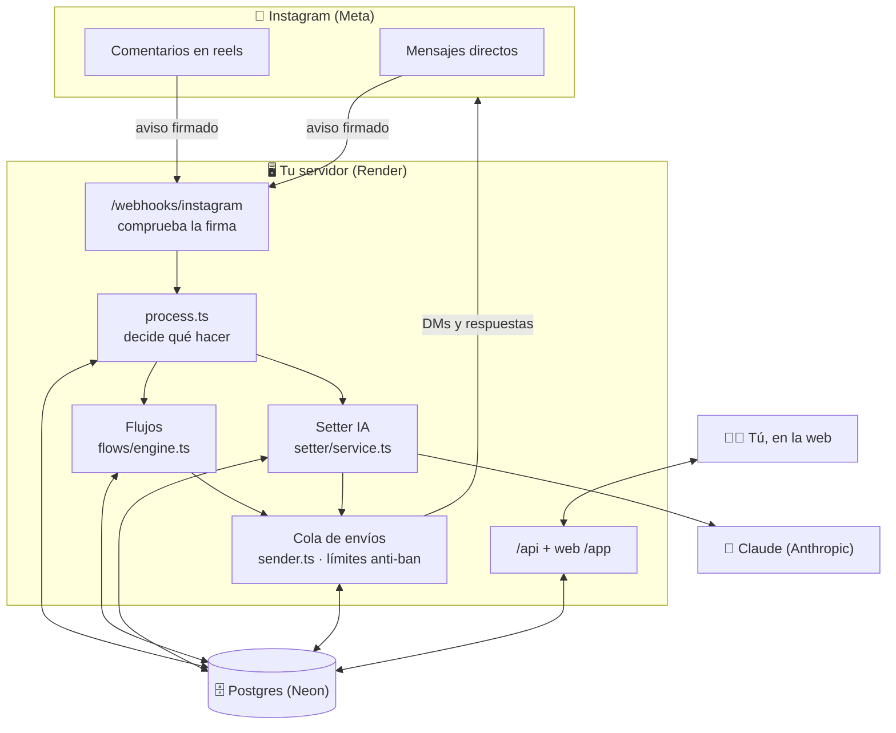
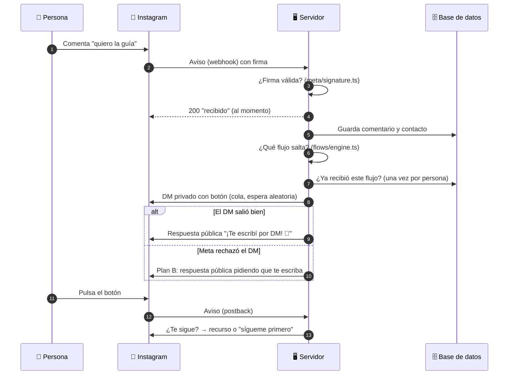
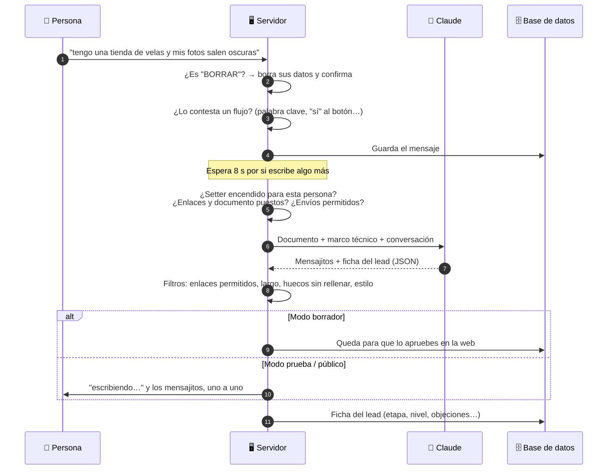
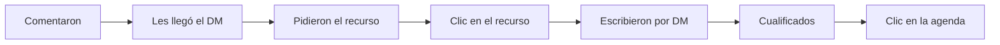
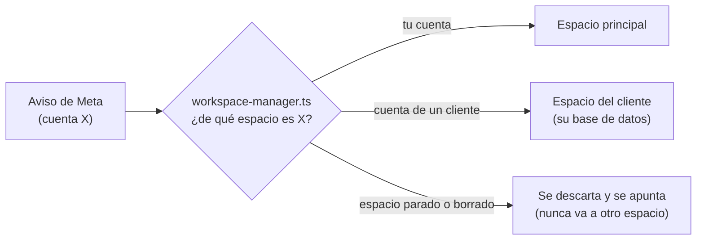

# 🔍 Cómo funciona por dentro

[← Volver al README](../README.md) · [Instalación](INSTALACION.md)

Este documento explica **qué pasa en cada momento**, con diagramas, y **dónde está cada cosa en el código**. Léelo con el código abierto al lado.

---

## 🗺️ La foto completa



**La idea clave:** Meta te **avisa** (webhook) cada vez que alguien comenta o escribe. Tu servidor responde *“recibido”* al momento y hace el trabajo después, en segundo plano. Todo lo que sale hacia Instagram pasa por **una cola** con límites por hora, para no parecer un robot.

---

## 💬 Recorrido 1: alguien comenta en tu reel



- **Nunca se dice “mira tus DMs” si el DM no salió** (la respuesta pública espera a que el DM salga bien).
- **Una vez por persona** (por reel o por flujo): si comenta 5 veces, recibe el DM una vez.
- Si el servidor se reinicia (al desplegar), 2 minutos después **recupera** los comentarios de los 15 minutos anteriores que no llegaron (`catch-up.ts`).

## 🤖 Recorrido 2: alguien te escribe por DM (el setter)



- **Modos del setter:** *Apagado* (guarda, no responde) · *Prueba* (solo a las cuentas que pongas) · *Público*. Además, *borrador*: la IA escribe y tú apruebas.
- **Si tú escribes a mano** desde Instagram, la IA **se calla** en esa conversación (`setter/echoes.ts`).
- **La IA se para sola** y te avisa si hay una queja, un problema con un pago o señales de que es menor.
- Lo que la IA sabe sale del **documento del setter** ([ejemplo](../ejemplos/documento-setter.md)); las reglas fijas (formato, seguridad, enlaces) del **marco técnico** (`setter/prompt.ts`), que también puedes editar en la web.

## 📊 Recorrido 3: las métricas



Cada paso sale de datos reales guardados (comentarios, envíos, clics en enlaces con seguimiento y la ficha de la IA). Los **enlaces con seguimiento** pasan por tu servidor (`/l/…`), que apunta el clic y redirige al destino real.

---

## 🛡️ Seguridad y anti-ban

| Qué | Cómo | Dónde |
|---|---|---|
| Solo aceptar avisos de Meta | Firma HMAC-SHA256 con tu App Secret; lo que no firma Meta se rechaza y **no se guarda** | `meta/signature.ts`, `app.ts` |
| Token de Instagram | Guardado **cifrado** (AES-256-GCM) y renovado solo cada 7 días | `meta/token.ts` |
| Límites por hora | 700 DMs a comentarios, 700 respuestas públicas, 3000 mensajes (configurables) | `config.ts`, `sender.ts` |
| Bloqueo de Meta (error 368) | Pausa **todos** los envíos 24 h; la cola espera, no descarta | `sender.ts` |
| Acceso a la web | Contraseñas con scrypt, sesión en cookie HttpOnly, 5 fallos = 15 min de bloqueo | `auth.ts`, `routes-api.ts` |
| Derecho al borrado | La persona escribe **BORRAR** por DM: se borra todo lo suyo y se le confirma | `data-deletion.ts` |
| Enlaces del setter | La IA solo puede escribir tus enlaces y tu correo; cualquier otro bloquea el mensaje | `setter/guards.ts` |

## 🏢 Espacios (varios clientes en un servidor)

Opcional y avanzado: desde **Configuración → Clientes** puedes crear *espacios* para otras cuentas de Instagram. Cada espacio tiene **su propia base de datos** y sus usuarios; los avisos de Meta se reparten por la cuenta de Instagram que los envía. Un espacio nuevo nace con los **envíos bloqueados** hasta que el administrador principal los activa. Si solo usas tu cuenta, no necesitas nada de esto.



---

## 📁 Dónde está cada cosa

| Carpeta / archivo | Qué hace |
|---|---|
| `src/index.ts` | Arranque: lee la configuración, abre la base y arranca el servidor. |
| `src/config.ts` | Todas las variables de entorno (ver [.env.example](../.env.example)). |
| `src/app.ts` | Rutas del servidor: webhook, enlaces, `/api`, la web y las páginas legales. |
| `src/process.ts` | Decide qué hacer con cada aviso de Meta. |
| `src/flows/` | Motor de flujos: disparadores, pasos, condiciones, plantillas. |
| `src/sender.ts` | La cola de envíos con límites, esperas y pausa por bloqueo. |
| `src/setter/` | El setter con IA: prompt, filtros, reglas, simulador y escenarios. |
| `src/meta/` | Hablar con Instagram: cliente de la API, avisos, firma y token. |
| `src/intelligence/` | Análisis de conversaciones con IA (objeciones, ideas de contenido). |
| `src/routes-api-*.ts` | La API que usa la web, una por sección. |
| `src/store*.ts` | Todo lo que se guarda en Postgres (las tablas se crean solas al arrancar). |
| `web/src/` | La web de gestión (React): una carpeta por sección. |
| `tests/` | 600+ pruebas automáticas (`npm test`). Usan un Postgres en memoria: no necesitan nada instalado. |
| `ejemplos/` | Documento del setter de ejemplo. |

### Comandos útiles

```bash
npm run dev        # servidor en modo desarrollo (lee .env, se reinicia al guardar)
npm run dev:web    # la web con recarga en caliente (http://localhost:5173/app, usa la API de :3000)
npm test           # todas las pruebas
npm run typecheck  # comprueba los tipos del servidor, las pruebas y la web
npm run build      # compila todo (lo que hace Render)
```

---

## ⚠️ Límites conocidos

- **Solo español**: el marco técnico del setter contesta siempre en español (lo puedes cambiar en *Setter IA → Marco técnico*).
- **Meta decide**: a algunas personas Instagram no deja mandarles el DM del comentario (error 2534025); para eso está el *plan B*. Si hay muchos rechazos, Meta puede restringir la cuenta.
- **Límite de intentos de login detrás de un proxy**: se usa la última IP de `X-Forwarded-For`, la que añade el proxy de Render. Si despliegas en otro sitio, revisa `clientIp` en `src/routes-api.ts`.
- **Espacios con envíos bloqueados**: lo que llegue mientras están bloqueados espera en la cola (en memoria) y sale al activarlos.
- **Memoria**: algunos registros por persona (intentos de login, colas del setter) viven en memoria hasta que el servidor se reinicia; para una cuenta normal no es un problema.
